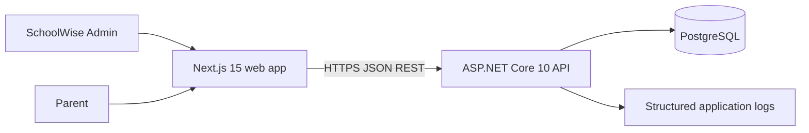

# SchoolWise Phase 1 Architecture

## Product boundary

SchoolWise helps parents in Greece discover, compare, and eventually review schools. Phase 1 delivers the technical foundation, authentication, public school discovery/details, and administrator CRUD. **Reviews, review verification, recommendations, matching, communities, and analytics are not implemented in Phase 1.**

Supported school types include nursery, kindergarten, elementary, middle, and high school. Schools can be public or private.

## System context



## Clean Architecture

- **SchoolWise.Domain** owns entities, enums, and domain invariants. It has no framework dependency.
- **SchoolWise.Application** owns CQRS commands/queries, handlers, validators, DTOs, mapping, result types, and repository/unit-of-work abstractions.
- **SchoolWise.Infrastructure** implements EF Core persistence, PostgreSQL configuration/seeding, repositories, unit of work, password hashing, and JWT/refresh-token services.
- **SchoolWise.Api** is the composition root and HTTP boundary: controllers, API versioning, auth policies, exception handling, Swagger, and Serilog.
- **Frontend** is a separate Next.js App Router application. Public homepage, catalogue, and school detail data are server-rendered; React Query and Axios handle client-side interactions, and Zod validates forms.

Feature slices are organized by bounded capability (`Auth`, `Schools`) inside Application. Each slice contains request/response DTOs, commands or queries, handlers, and FluentValidation validators where input validation is needed. Controllers only map HTTP to MediatR and map application results to HTTP.

## Request and persistence flow

```text
HTTP request -> API authentication/validation -> controller -> MediatR
  -> FluentValidation pipeline -> handler -> repository/UoW
  -> EF Core/PostgreSQL -> Result<T> -> ProblemDetails or response DTO
```

Read-only school search uses a no-tracking query and server-side filters, sorting, and pagination. Details include ordered photos. Writes are transactional, tenant-independent (schools are public listings), and role-restricted; Serilog records request outcomes.

## Security

- Passwords use ASP.NET Core's `PasswordHasher<User>`; raw passwords are never persisted or logged.
- JWTs are short-lived access credentials. Opaque refresh tokens are stored as SHA-256 hashes, rotated on refresh, and revocable.
- The active `AdminOnly` policy protects school management. `SchoolAdmin` remains a supported role value, but no SchoolAdmin-scoped workflow is part of Phase 1.
- JWT signing secret and database credentials come from environment configuration/user secrets, not committed defaults.
- Request validation and ProblemDetails protect the API boundary. Login and registration require rate limiting before production.
- Public school listing/detail endpoints reveal only approved schools. Admin list/manage endpoints can include unapproved schools.

## Deployment

Docker Compose runs `postgres`, a one-shot `migrate` job, `api`, and `frontend`. The migration job waits for PostgreSQL health and must complete successfully before the API starts; API replicas do not run DDL at startup. Development-only sample seeding runs from the API after the migration job succeeds. Production should use managed PostgreSQL, HTTPS termination, secret management, backups, and persistent structured log collection.

## Phase 1 non-goals and decisions

- No reviews, review moderation, votes, or verification evidence.
- No image upload service; `LogoUrl` and photo URLs are externally managed URLs.
- No school-admin self-service scope; the specified school write endpoints require the global Admin role.
- Facilities are represented in school description for now; structured facility taxonomy is deferred.
- API uses `/api/v1` routing and OpenAPI/Swagger documentation.
