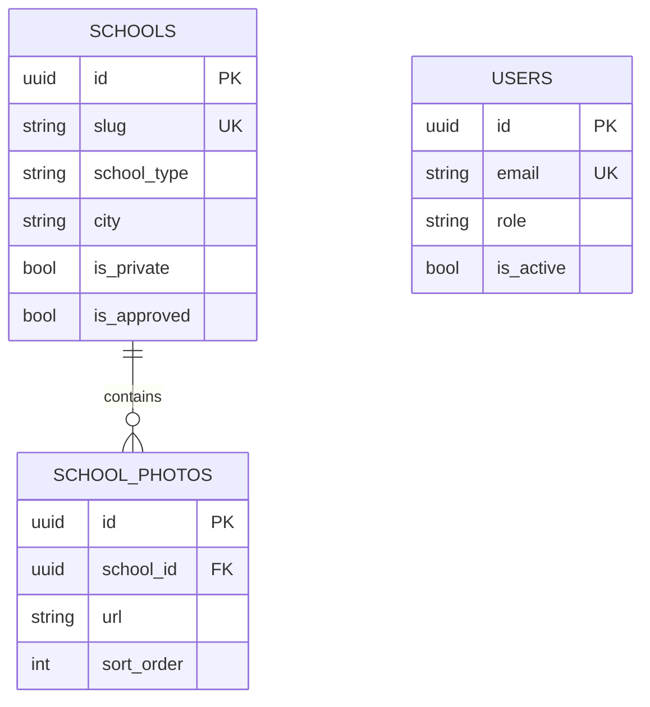
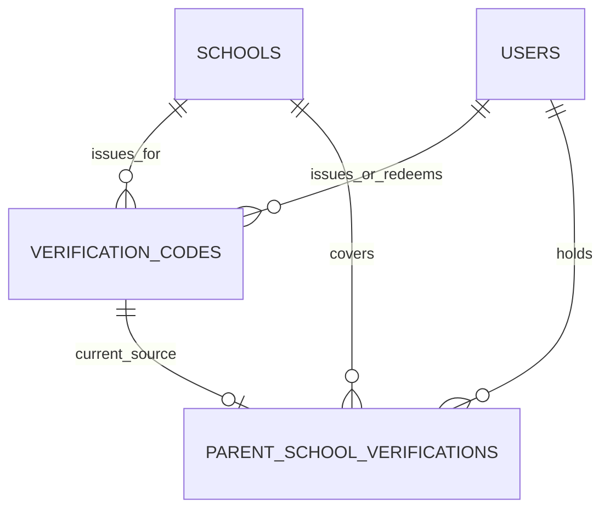
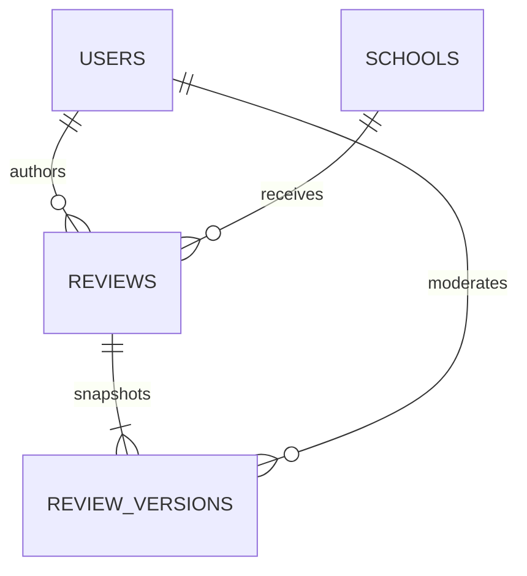

# SchoolWise Database Schema

Database: PostgreSQL. Keys use UUIDs. Timestamps are UTC. EF Core owns migrations and database constraints.

## Tables

### `users`

| Column | Type | Rules |
|---|---|---|
| `id` | uuid | PK |
| `first_name` | varchar(100) | required |
| `last_name` | varchar(100) | required |
| `email` | varchar(320) | required, unique, normalized to lowercase |
| `password_hash` | text | required, ASP.NET Identity PasswordHasher format |
| `role` | varchar(32) | `Parent`, `SchoolAdmin`, `Admin` |
| `is_active` | boolean | required |
| `created_at` | timestamptz | required |

### `schools`

| Column | Type | Rules |
|---|---|---|
| `id` | uuid | PK |
| `name` | varchar(200) | required |
| `slug` | varchar(220) | required, unique, URL-safe |
| `description` | text | optional |
| `school_type` | varchar(32) | Nursery, Kindergarten, Elementary, MiddleSchool, HighSchool |
| `address` | varchar(300) | required |
| `city` | varchar(120) | required, indexed |
| `postal_code` | varchar(16) | optional |
| `phone` | varchar(32) | optional |
| `email` | varchar(320) | optional |
| `website` | varchar(500) | optional |
| `tuition_from` / `tuition_to` | numeric(10,2) | optional, non-negative, lower <= upper |
| `student_capacity` | integer | optional, positive |
| `established_year` | integer | optional |
| `is_private` | boolean | required |
| `logo_url` | varchar(1000) | optional |
| `is_approved` | boolean | required; public endpoints filter true |
| `created_at` | timestamptz | required |

### `school_photos`

| Column | Type | Rules |
|---|---|---|
| `id` | uuid | PK |
| `school_id` | uuid | required FK to schools, cascade delete |
| `url` | varchar(1000) | required |
| `sort_order` | integer | required, non-negative |

Index `(school_id, sort_order)`.

## Relationships

## Refresh token storage

Refresh tokens are persisted in `refresh_tokens` to support rotation and revocation:

- `id` uuid primary key
- `user_id` uuid foreign key to `users` (cascade delete)
- `token_hash` varchar(64), unique SHA-256 hex digest
- `expires_at`, `created_at`, `revoked_at` timestamptz
- nullable `replaced_by_token_hash` varchar(64)

Only the hash is stored; the clear token is returned once at login/refresh. Add an index on `(user_id, expires_at)`.

## Search and indexing

- B-tree index on `schools(city, school_type, is_private, is_approved)`.
- `pg_trgm` GIN indexes on school name, city, address, and description support the API's case-insensitive substring keyword search.
- Unique index on normalized `users(email)` and `schools(slug)`.
- Tuition filter uses range predicates (`tuition_to >= min` and `tuition_from <= max`), with null ranges treated as unspecified.
- Keyword search uses PostgreSQL `ILIKE` against name, city, address, and description; filters and pagination execute in SQL and never load the full catalogue into application memory.

## Seed data

Development seeds include Admin/Parent accounts and representative approved Athens-area nursery, kindergarten, elementary, and public/private school listings. Seed passwords are development-only and documented in the root README; production startup never seeds demo credentials.

## Phase 2 eligibility foundation

Migration: `AddSchoolVerification`. This is the first implementation slice, not the complete target schema in [Phase2-Database.md](Phase2-Database.md).

### `verification_codes`

- UUID `id`, school FK, issuer FK and `created_at`.
- Unique `secret_hash` varchar(64): SHA-256 of a normalized, cryptographically generated 192-bit code. No plaintext column.
- UTC `expires_at` (redemption deadline) and `valid_until` (resulting parent-school eligibility deadline).
- Nullable `redeemed_at` / `redeemed_by` record a single redemption.
- Nullable `revoked_at` / `revoked_by` / `revocation_reason` record revocation and its actor/reason.
- Check constraints enforce valid dates and complete redemption/revocation metadata.
- Optimistic concurrency on both terminal timestamps, with a transactional grant write, prevents double redemption and stale revoke/redemption races.
- Indexes cover secret lookup and paged school-code history. User/school FKs restrict deletion to preserve audit.

### `parent_school_verifications`

- UUID `id`; required `user_id`, `school_id`, `code_id`, `verified_at`, `valid_until`.
- Unique `(user_id, school_id)` keeps one current grant; unique `code_id` prevents duplicate grants from one code.
- Composite FK `(code_id, school_id)` ensures the source code belongs to the same school.
- An unexpired, unrevoked grant cannot consume a second code. Renewal after expiry/revocation updates this current record, guarded by a concurrency token on `code_id`.
- Older source codes retain their immutable issuer/recipient/timestamps/validity metadata; revoking an older source cannot revoke a replacement grant.
- Effective status is `Revoked` when the current source code is revoked, otherwise `Expired` when `valid_until <= now`, otherwise `Active`.
- Account IDs and evidence never appear in public responses. Account erasure/audit retention procedures are still required before real-parent enrollment.

For this code-only slice, the code row is the issuance/redemption/decision audit; a second `verification_requests` workflow is deliberately not duplicated. Documents and human evidence decisions remain unimplemented. The review sprint below is independent of these grants.

## Review sprint

Migration: `AddReviews`, after existing migrations. No extra database/storage provider is required.

### `reviews`

- UUID `id`, required `school_id` and author `user_id`, unique `(user_id, school_id)`.
- All six integer rating fields with a database check enforcing 1-5.
- `pros` / `cons` varchar(1000), nullable; required `review_text` varchar(5000).
- `status` varchar(32): `PendingModeration`, `Published`, `Rejected`, database-checked.
- Positive `version`, UTC `created_at`, `updated_at`, nullable `deleted_at`.
- Optimistic concurrency on version, status and deletion timestamp. Create/edit/delete/moderation and snapshot changes commit in one SaveChanges transaction.
- School/author FKs restrict deletion to preserve version/decision history. School/status/update-time and moderation status/update-time indexes support lists.

### `review_versions`

- UUID `id`; required `review_id`, positive version; unique `(review_id, version)`.
- Immutable content snapshot with the same rating/text fields and rating checks.
- `status`, `submitted_at`, nullable `reviewed_at`, `reviewed_by`, parent-visible `moderation_notes` (max 1,000), and `withdrawn_at`.
- Only decision/withdrawal metadata changes after creation; edits create a new version rather than overwriting content.
- Check constraints require a decision actor/time for Published or Rejected and no decision for pending snapshots.
- Concurrency on status/withdrawal prevents stale version decisions; FK to review/reviewing user restricts deletion.

The current review holds the content/version used by public queries. An edit immediately changes status to PendingModeration and marks the previous snapshot withdrawn/superseded. Deletion sets `deleted_at`; old text remains in private history. Resubmission after deletion increments the same review's version, so a Parent cannot accumulate separate review identities for one school.

These private histories are not a complete GDPR erasure solution. Define operational retention/erasure, handling of legal holds and backup restoration before accepting real user content; do not retain personal review text indefinitely.

