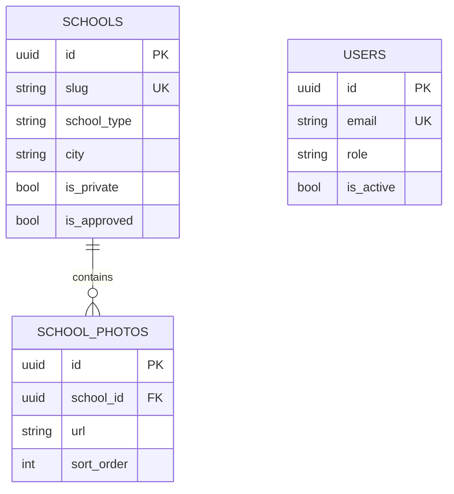

# SchoolWise Database Schema

Database: PostgreSQL. Keys use UUIDs. Timestamps are UTC. EF Core owns migrations and database constraints.

## Tables

### `users`

| Column | Type | Rules |
|---|---|---|
| `id` | uuid | PK |
| `first_name` | varchar(100) | required |
| `last_name` | varchar(100) | required |
| `email` | varchar(320) | required, unique, normalized to lowercase |
| `password_hash` | text | required, ASP.NET Identity PasswordHasher format |
| `role` | varchar(32) | `Parent`, `SchoolAdmin`, `Admin` |
| `is_active` | boolean | required |
| `created_at` | timestamptz | required |

### `schools`

| Column | Type | Rules |
|---|---|---|
| `id` | uuid | PK |
| `name` | varchar(200) | required |
| `slug` | varchar(220) | required, unique, URL-safe |
| `description` | text | optional |
| `school_type` | varchar(32) | Nursery, Kindergarten, Elementary, MiddleSchool, HighSchool |
| `address` | varchar(300) | required |
| `city` | varchar(120) | required, indexed |
| `postal_code` | varchar(16) | optional |
| `phone` | varchar(32) | optional |
| `email` | varchar(320) | optional |
| `website` | varchar(500) | optional |
| `tuition_from` / `tuition_to` | numeric(10,2) | optional, non-negative, lower <= upper |
| `student_capacity` | integer | optional, positive |
| `established_year` | integer | optional |
| `is_private` | boolean | required |
| `logo_url` | varchar(1000) | optional |
| `is_approved` | boolean | required; public endpoints filter true |
| `created_at` | timestamptz | required |

### `school_photos`

| Column | Type | Rules |
|---|---|---|
| `id` | uuid | PK |
| `school_id` | uuid | required FK to schools, cascade delete |
| `url` | varchar(1000) | required |
| `sort_order` | integer | required, non-negative |

Index `(school_id, sort_order)`.

## Relationships

## Refresh token storage

Refresh tokens are persisted in `refresh_tokens` to support rotation and revocation:

- `id` uuid primary key
- `user_id` uuid foreign key to `users` (cascade delete)
- `token_hash` varchar(64), unique SHA-256 hex digest
- `expires_at`, `created_at`, `revoked_at` timestamptz
- nullable `replaced_by_token_hash` varchar(64)

Only the hash is stored; the clear token is returned once at login/refresh. Add an index on `(user_id, expires_at)`.

## Search and indexing

- B-tree index on `schools(city, school_type, is_private, is_approved)`.
- `pg_trgm` GIN indexes on school name, city, address, and description support the API's case-insensitive substring keyword search.
- Unique index on normalized `users(email)` and `schools(slug)`.
- Tuition filter uses range predicates (`tuition_to >= min` and `tuition_from <= max`), with null ranges treated as unspecified.
- Keyword search uses PostgreSQL `ILIKE` against name, city, address, and description; filters and pagination execute in SQL and never load the full catalogue into application memory.

## Seed data

Development seeds include Admin/Parent accounts and representative approved Athens-area nursery, kindergarten, elementary, and public/private school listings. Seed passwords are development-only and documented in the root README; production startup never seeds demo credentials.
