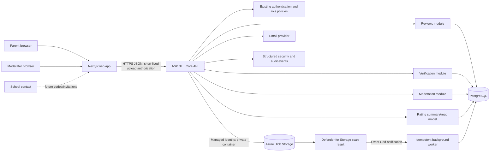

# SchoolWise Phase 2 Architecture

**Status:** Design only; no Phase 2 code or database objects are implemented.  
**Scope:** Verified parent eligibility, reviews, moderation, trust indicators, and privacy controls.

## 1. Product and trust boundary

Phase 2 adds a trust layer to the existing Phase 1 Clean Architecture application. Keep the existing ASP.NET Core API, PostgreSQL database, and Next.js application. Implement this as a **modular monolith**, not as separate review, verification, and moderation services: the expected 100,000-review scale does not justify distributed transactions, additional deployment units, or a service bus at launch.

The public promise must be precise:

> “Verified parent” means SchoolWise checked evidence that the adult account holder is a parent or legal guardian associated with the school at the time of verification. It is not a guarantee that every opinion is true, that the parent is currently enrolled, or that SchoolWise endorses the review.

Never expose the parent's legal name, email address, child identity, verification method, uploaded evidence, or moderator notes on public pages. Reviews are publicly pseudonymous, not absolutely anonymous: a school or community member may infer an author's identity from the story itself.

## 2. Logical architecture

### Existing application boundaries

- **Domain:** review, verification, and moderation rules; no Azure or HTTP dependencies.
- **Application:** CQRS use cases, authorization requirements, DTOs, validation, and repository/unit-of-work abstractions.
- **Infrastructure:** EF Core/PostgreSQL, Azure Blob adapter, managed-identity token acquisition, email, background processing, and audit persistence.
- **API:** versioned routes, request limits, authentication, rate limiting, ProblemDetails, and request-to-use-case mapping.
- **Frontend:** parent review/verification flows, public school reviews, and role-protected moderator queues.

Place feature slices in the existing Application structure (for example `Reviews`, `Verifications`, and `Moderation`). Do not introduce a generic workflow engine or a new repository abstraction solely for Phase 2. Reuse existing validation, mapping, result, logging, and unit-of-work patterns.

## 3. Core design decisions

| Decision | Phase 2 design |
|---|---|
| Deployment | One API and one PostgreSQL database; asynchronous work via a small idempotent worker/outbox. Add Azure Service Bus only if measured queue load or operational isolation requires it. |
| Verification | Manual review of one narrowly scoped enrollment document for the initial broad pilot. School-issued codes/invitations are a lower-data partner option after school-scoped administration exists. An email address alone never proves parenthood. |
| Review publishing | A verified Parent may submit one active review per school. Every submission/edit is an immutable version and is moderated before it becomes public. |
| Editing a published review | Keep the last approved version visible while a changed version is pending. On approval, atomically switch the public version. A rejected edit does not erase the previously approved version. |
| Deletion | Immediately unpublish on parent deletion or moderator removal. Retain only the minimum audit evidence for a defined, counsel-reviewed period; do not treat “immutable history” as permission for indefinite personal-data retention. |
| Rating | Only approved, verified-parent reviews count. Use a simple arithmetic mean; do not add a hidden trust weight or let unverified ratings influence the score. |
| Public identity | Display “Verified parent review” and the review date; never display the verification method or parent identity. Avoid a public “review quality” score. |
| Moderation | Human decisions for publication, verification, and account sanctions. Automated signals may prioritize a queue but must not be the sole reason for rejection or removal. |
| Document storage | Azure Blob Storage private quarantine container, short-lived user-delegation SAS for direct upload, Managed Identity for service access, malware scanning, audited moderator reads, and automatic deletion. |

## 4. Verification methods and MVP choice

| Method | What it proves | Coverage and operational cost | Main risks | Recommendation |
|---|---|---|---|---|
| **A. Document upload** (school enrollment confirmation, school-issued letter, or a redacted tuition receipt) | Evidence of a parent/guardian relationship with a named school, subject to human review | Broadest coverage across Greek schools; requires trained reviewers and secure document handling | Child/financial data exposure, forged files, reviewer error, moderation cost | **Initial broad-pilot method.** Accept the least revealing proof; manually review; never request a child's ID, AMKA, birth certificate, grades, or medical information. |
| **B. School-issued code** | Possession of a one-time code distributed through a school's trusted channel | Fast for families and low privacy burden; requires school cooperation and code issuance/revocation | Code forwarding, staff misuse, poor school operational controls | Add for partner schools after the school-scoped issuance process is ready. High-entropy, one-use, expiring, hashed at rest. |
| **C. School-admin invitation** | A school-authorized invitation to a particular parent contact | Low document burden; requires authenticated, scoped school administrators and a reliable parent email | Compromised school accounts, invitation sent to the wrong adult, staff conflicts | A partner-school method; require email match, expiry, issuer audit, and parent confirmation. School staff cannot review the resulting public content. |
| **D. Verified email workflow** | Control of an email inbox; a school-domain address may additionally indicate affiliation | Very low implementation cost, but many parents do not have school email and some staff do | Confuses mailbox control with parental status; domain/shared mailbox errors | Require ordinary account-email confirmation for all accounts. Treat school-domain email only as corroborating evidence, never as standalone proof of parenthood or a grant by itself. |

The MVP should not launch with four nominal methods. Start with **Method A and trained human review** for the selected pilot schools. If schools can reliably issue codes, offer Method B as an alternative that avoids document collection. Do not promise complete Greek-school coverage until verification operations and legal safeguards are staffed.

An approved relationship record is valid for a defined period (recommended: 12 months or until the end of the relevant school year, whichever comes first). Existing reviews retain the historically accurate label “Verified parent at time of review”; expiry prevents new submissions but does not retroactively imply a published review was never verified.

## 5. Review and moderation lifecycle

The review's current workflow status is `Draft`, `PendingModeration`, `Published`, `Rejected`, or `Archived`. A review also points to:

- the **current version** being edited or reviewed; and
- the **published version**, if one exists.

This distinction lets an approved version remain public while an edit is under moderation. The exact transition rules and database constraints are defined in [Phase2-Database.md](Phase2-Database.md); moderation ownership and service levels are in [Phase2-Moderation.md](Phase2-Moderation.md).

Only authenticated, verified Parents may create or submit reviews. Overall rating is required (1–5). Category ratings are nullable when the parent lacks enough experience to assess that aspect; zero is never a rating. Public display includes the overall rating, available category averages, verified count, total published count, and recent approved versions.

## 6. Document security on Azure

Use a private Blob Storage account/container; disallow anonymous blob access, require HTTPS, and use Azure RBAC. The API's managed identity receives only the data-plane rights it needs. Do not place account keys or long-lived SAS tokens in the frontend or database.

Recommended upload flow:

1. The authenticated parent creates a pending verification request and asks the API for one upload session.
2. The API authorizes the request, generates an opaque unpredictable blob name, and issues a **single-blob, write-only user-delegation SAS** with a short expiry (target 5–10 minutes). It does not grant list/read/delete permissions. Enforce an account SAS-expiration policy where supported.
3. The browser uploads directly to a private quarantine container over HTTPS. Accept only the documented small allowlist (PDF, JPEG, PNG), enforce a small product limit (initially 10 MB), and treat filename, MIME type, and client-supplied size as untrusted.
4. The service verifies blob ownership, actual size, signature/content type, and digest; malware scanning must report a clean result before moderator access. A missing, unsupported, or failed scan result remains quarantined, not “clean.”
5. A moderator opens evidence through an authenticated, audited server-side access path. Do not show blob URLs in queue DTOs. Log who accessed which document, when, and for which case.
6. Delete the original promptly after the decision/appeal window. Lifecycle policies remove abandoned uploads and failed requests. A parent can remove an upload before review.

Use service-side encryption and TLS as the baseline. Consider customer-managed keys in Key Vault only if the DPIA, contract, or threat model justifies their added rotation and recovery burden. Select an EU Azure region after confirming required service availability, backups, support access, and contractual residency; “EU region” alone is not a blanket GDPR guarantee. Use a private endpoint/network restrictions for production where operationally feasible.

Microsoft Defender for Storage on-upload malware scanning can feed scan results through Event Grid. Treat the scan result as an input to the quarantine state machine, not as proof that a document is authentic or safe to publish. Verify current service limits, supported file types, cost, regional availability, and failure behavior before selecting it as the sole scanner. See [Azure security guidance](Phase2-Architecture.md#references).

## 7. Rating and public trust model

Use **Option A: only verified, published reviews count**. Each eligible review contributes weight 1.0; unverified, pending, rejected, archived, or removed reviews contribute 0. The score is a simple mean over the currently published version of each active review. Show the overall mean only after five distinct verified reviewers have published; show each category mean only when at least five distinct reviewers rated that category. This threshold reduces small-cohort exposure but does not guarantee anonymity. Display counts and an explicit unavailable state; free text may still identify its author.

Do not silently decay older reviews or apply a Bayesian prior at launch. Show the review count and last-updated date so families can judge sample size and recency. Hide the numeric overall/category score until at least five distinct verified reviewers have a published review; below that threshold show “Not enough reviews for a score” and an accurate count. Review text may still be shown after moderation, but public content must not expose the author or child. Re-evaluate the threshold with a privacy review and pilot data.

## 8. Scale and operations

At 10,000 users, 1,000 schools, and 100,000 reviews, PostgreSQL remains appropriate. A bounded query by school, status, and publication date plus a rating aggregate is not a distributed-systems problem. Use the indexes in [Phase2-Database.md](Phase2-Database.md), cursor pagination for moderation queues, and short-lived caching only for public summaries and pages. Invalidate those caches on publish, replace, remove, or anonymize events.

Do not cache verification status, moderator queues, document links, or private review drafts in a shared public cache. Use an outbox/idempotent worker for email, scan-result processing, and cache invalidation so a retry cannot publish a review twice or approve a request twice.

## References

- [Secure your Azure Blob Storage](https://learn.microsoft.com/en-us/azure/storage/blobs/secure-blobs)
- [Azure Storage security recommendations](https://learn.microsoft.com/en-us/azure/storage/blobs/security-recommendations)
- [Defender for Storage on-upload malware scanning](https://learn.microsoft.com/en-us/azure/defender-for-cloud/on-upload-malware-scanning)
- [Understand malware scan results and limitations](https://learn.microsoft.com/en-us/azure/defender-for-cloud/understand-malware-scan-results)
- [GDPR, Regulation (EU) 2016/679](https://eur-lex.europa.eu/eli/reg/2016/679/oj/eng)
- [Digital Services Act (EU) 2022/2065](https://eur-lex.europa.eu/eli/reg/2022/2065/oj/eng)

