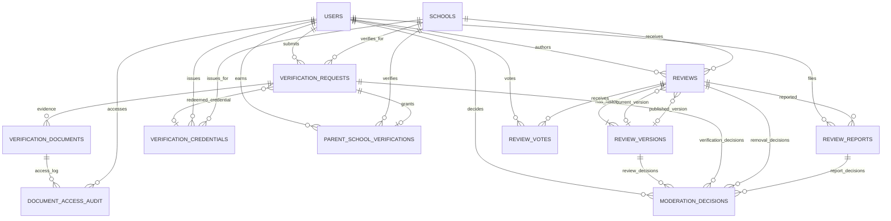

# SchoolWise Phase 2 Database Design

**Status:** Logical design only; no entities, migrations, or database changes have been created.  
**Database:** Existing PostgreSQL database; UUID primary keys and UTC `timestamptz` timestamps, consistent with [Phase 1](DatabaseSchema.md).

## 1. Design principles

- Keep review content as immutable versions; do not overwrite the text/rating that was actually published.
- Keep current workflow state separate from the version currently visible to the public.
- Preserve moderation decisions as append-only operational audit, but allow personal content to be erased or pseudonymized when legally required.
- Store evidence bytes only in private Azure Blob Storage. PostgreSQL stores opaque storage keys and scan/access metadata, never SAS URLs or document contents.
- Enforce one active review per parent and school in PostgreSQL, not only in application code.
- Use explicit foreign keys and partial indexes. Do not use an unconstrained polymorphic `entity_type/entity_id` pair for moderation targets.

## 2. ERD

`USERS` and `SCHOOLS` are the existing Phase 1 tables. The current Phase 1 roles are `Parent`, `SchoolAdmin`, and `Admin`; Phase 2 adds a separately assigned `Moderator` role. Public review records never expose `user_id`.

## 3. Entities and fields

Types below are logical PostgreSQL types; names can follow the existing snake-case EF convention. Check constraints and indexes are part of the design, not optional application validation.

### `reviews`

| Field | Type | Rules |
|---|---|---|
| `id` | uuid | PK |
| `user_id` | uuid | FK `users.id`, required author |
| `school_id` | uuid | FK `schools.id`, required |
| `status` | varchar(32) | `Draft`, `PendingModeration`, `Published`, `Rejected`, `Archived` |
| `current_version_id` | uuid | FK `review_versions.id`; current editable/most recently submitted version |
| `published_version_id` | uuid, nullable | FK `review_versions.id`; last approved version shown publicly |
| `created_at`, `updated_at` | timestamptz | Required, UTC |
| `archived_at` | timestamptz, nullable | Set on user deletion or moderator removal |

The pointers are nullable during initial creation; the application creates the review, creates its first version, then sets `current_version_id` in one transaction. `published_version_id` is null until first approval. It is cleared on archive/removal.

### `review_versions`

| Field | Type | Rules |
|---|---|---|
| `id` | uuid | PK |
| `review_id` | uuid | FK `reviews.id`, required |
| `version_number` | integer | Starts at 1; unique with `review_id` |
| `status` | varchar(32) | `Draft`, `PendingModeration`, `Published`, `Rejected`, `Superseded`, `Withdrawn` |
| `overall_rating` | smallint | Required, check 1–5 |
| `teaching_rating`, `safety_rating`, `communication_rating`, `facilities_rating`, `activities_rating` | smallint, nullable | Each null or check 1–5; null means “not enough experience,” never zero |
| `pros`, `cons` | varchar(1000), nullable | Plain text; no HTML |
| `review_text` | varchar(5000) | Required; enforce product minimum/maximum length in validation |
| `locale` | varchar(10) | Allowlisted locale, initially `el` or `en` |
| `created_at` | timestamptz | Required |
| `submitted_at`, `published_at` | timestamptz, nullable | Workflow timestamps |

Once submitted, the content/rating fields are immutable. An edit creates a new row and increments `version_number`. Internal notes do not belong in this table.

### `verification_requests`

| Field | Type | Rules |
|---|---|---|
| `id` | uuid | PK |
| `user_id`, `school_id` | uuid | Required FKs |
| `method` | varchar(40) | `DocumentUpload`, `SchoolCode`, `SchoolAdminInvitation`, `SchoolEmailCorroboration` |
| `status` | varchar(32) | `Pending`, `Approved`, `Rejected`, `Expired` |
| `credential_id` | uuid, nullable | FK `verification_credentials.id`; only code/invitation/email workflows |
| `submitted_at` | timestamptz | Required |
| `reviewed_at` | timestamptz, nullable | Set only on a human decision |
| `reviewed_by` | uuid, nullable | FK to the moderator/admin user |
| `rejection_reason_code` | varchar(50), nullable | Controlled value; never put private evidence in this field |
| `rejection_reason` | varchar(500), nullable | User-facing explanation; no internal fraud signals |
| `valid_until` | timestamptz, nullable | Set on approval |
| `created_at`, `updated_at` | timestamptz | Required |

One pending request per `(user_id, school_id)` at a time. A rejected/expired request remains an auditable attempt; a new request can be created after the previous one is closed. Enforce allowed transitions in the domain/application layer and with concurrency checks.

### `parent_school_verifications`

The current eligibility grant is separate from historical requests so that a later expiry/revocation does not rewrite the prior decision.

| Field | Type | Rules |
|---|---|---|
| `id` | uuid | PK |
| `user_id`, `school_id` | uuid | Required FKs; unique pair |
| `source_request_id` | uuid | FK to the approved request |
| `verified_at`, `valid_until` | timestamptz | Required |
| `revoked_at` | timestamptz, nullable | Ends current eligibility immediately |
| `revocation_reason_code` | varchar(50), nullable | Restricted, audited value |

A new approved request updates/replaces the current grant and retains the old request. When `valid_until` passes, the grant is ineligible even if a background job has not marked it expired; the expiry worker also transitions the request to `Expired` and records the transition time. Use a unique `(user_id, school_id)` row and transactionally replace its source/validity; do not keep multiple active grants. `SchoolEmailCorroboration` alone cannot approve a request or create a grant.

### `verification_documents`

| Field | Type | Rules |
|---|---|---|
| `id` | uuid | PK |
| `verification_request_id` | uuid | FK, required |
| `blob_key` | varchar(500) | Opaque generated key; no user filename/path |
| `detected_content_type` | varchar(100) | Server-detected allowlisted type |
| `size_bytes` | bigint | Positive and below configured limit |
| `sha256` | char(64) | Integrity/deduplication signal; treat as potentially sensitive metadata |
| `scan_status` | varchar(32) | `Pending`, `Clean`, `Malicious`, `NotScanned`, `Failed` |
| `uploaded_at`, `deleted_at` | timestamptz | Required upload time; deletion recorded |

Never store a SAS URL, shared key, original filename, child name, OCR output, or extracted document text. Set a separate lifecycle policy for orphaned blobs and a deletion job that reconciles database metadata with Blob Storage.

### `verification_credentials` (partner methods; not required for initial MVP)

| Field | Type | Rules |
|---|---|---|
| `id` | uuid | PK |
| `school_id` | uuid | FK, required |
| `method` | varchar(32) | `SchoolCode` or `SchoolAdminInvitation` |
| `secret_hash` | char(64) | Hash/HMAC of random token; never store the raw code |
| `invited_email_hash` | char(64), nullable | HMAC of normalized email for invitations; not a plain email |
| `issued_by` | uuid | FK to authorized, school-scoped issuer |
| `expires_at`, `redeemed_at`, `revoked_at` | timestamptz | Required expiry; optional terminal times |

Use high-entropy, single-use credentials. Codes and invitations expire, can be revoked, and are rate-limited on redemption. School administrators receive no access to parent documents or reviews. Email-domain control is not a substitute for this table or for proof of parenthood.

### `moderation_decisions`

Append-only decision history. It has nullable foreign keys to supported target types and a check constraint requiring **exactly one** target:

- `review_version_id` for approve/reject of a submission;
- `review_id` for removal/restore of published content;
- `verification_request_id` for approve/reject of evidence; or
- `review_report_id` for report disposition.

Common fields: `id`, `moderator_user_id`, `decision` (controlled enum), `reason_code`, `user_facing_reason`, `internal_note` (bounded and access-restricted), `created_at`, and optional `correlation_id`. Never update or delete a decision to hide a prior action; append a correction/appeal decision. Keep internal notes separate from the statement sent to the parent.

### `review_reports`

Fields: `id`, `review_id`, `reporter_user_id`, `category` (`PersonalData`, `StaffIdentification`, `FalseOrFraudulent`, `Harassment`, `IllegalContent`, `Other`), bounded `description`, `status` (`Open`, `UnderReview`, `Actioned`, `Dismissed`, `Withdrawn`), `created_at`, `closed_at`. Require an authenticated reporter for the MVP; prevent duplicate open reports by the same reporter for the same review. Reports are private; do not publish reporter identity or report counts.

### `review_votes` (defer from MVP)

Fields: `id`, `review_id`, `user_id`, `vote` (`Helpful` only), `created_at`. Unique `(review_id, user_id)`. Only verified Parents may vote; a vote never changes a rating score. Defer until there is evidence that helpfulness sorting solves a user problem.

### `document_access_audit`

Fields: `id`, `verification_document_id`, `actor_user_id`, `case_id`, `accessed_at`, `purpose_code`, and request correlation ID. Append on every evidence view/download. Do not log SAS values, content, parent/child names, or raw document URLs. Retain according to the reviewed audit schedule.

### `school_rating_summaries` (optional read model)

Derived, rebuildable per-school data only: `school_id` PK, published verified review count, overall sum/count, category sums/counts, and `updated_at`. Do not store author-level identifiers in the aggregate. Start with SQL aggregation; add this projection only if measured latency requires it.

## 4. Relationships and cardinality

| Relationship | Cardinality | Notes |
|---|---|---|
| User → Review | 1:N | A parent may review different schools; a partial unique constraint limits active reviews per school. |
| School → Review | 1:N | Publicly approved schools only accept new reviews. |
| Review → ReviewVersion | 1:N | At least one version; version number unique within review. |
| Review → current/published version | N:1 optional pointers | Both pointers must reference a version belonging to that same review; validate in transaction/domain logic. |
| User/School → VerificationRequest | 1:N each | Retains attempts and decisions. |
| VerificationRequest → VerificationDocument | 1:N | One document is sufficient for MVP; cap the count and size. |
| VerificationRequest → ParentSchoolVerification | 0:1 current grant | Only Approved requests can issue/update a grant. |
| User/School → ParentSchoolVerification | 1:0..1 | Unique pair; revoked or expired grants cannot authorize a new submission. |
| School → VerificationCredential | 1:N | Future partner-school code/invitation workflow. |
| ReviewVersion / Review / Request / Report → ModerationDecision | 1:N | Decisions are immutable history; use explicit nullable FKs with an exactly-one check. |
| Review → Report/Vote | 1:N | Reporter/voter uniqueness rules prevent easy duplicate manipulation. |

## 5. Constraints and indexes

1. **One active review:** partial unique index on `(user_id, school_id) WHERE status <> 'Archived'`. `Rejected` and `Draft` still occupy the slot. Archiving hides the prior review and permits a fresh one; do not hard-delete to evade this rule.
2. **Version identity:** unique `(review_id, version_number)`; index `(review_id, created_at DESC)`.
3. **Public review page:** index `(school_id, published_at DESC, id)` for records with a non-null `published_version_id` and non-archived status. The public query reads that pointed-to version, not an unreviewed current version.
4. **Review moderation queue:** partial index on `(submitted_at, id)` for pending versions; use stable cursor pagination.
5. **Verification queue:** partial index on `(submitted_at, id)` where status is Pending.
6. **Single pending verification:** partial unique `(user_id, school_id)` where status is Pending.
7. **Current verification:** unique `(user_id, school_id)` on `parent_school_verifications`; index `valid_until` for expiry processing.
8. **Reports:** index `(status, created_at, id)`; partial unique `(review_id, reporter_user_id)` for open reports.
9. **Votes:** unique `(review_id, user_id)`; secondary `(review_id, vote)` only if vote summaries are later used.
10. **Documents and credentials:** unique `blob_key`; unique `secret_hash`; index `(verification_request_id, scan_status)`.
11. Add check constraints for every 1–5 rating, text length, valid positive sizes, and approved/rejected state fields. Never rely only on a form validator.
12. Do not add a full-text index on private drafts, reports, evidence, or moderator notes. Public review search is not an MVP feature.

PostgreSQL partial indexes cannot use a volatile `now()` condition. Enforce current validity with `valid_until > current_timestamp` in the authorization query; a scheduled expiry job is housekeeping, not the security boundary.

## 6. Review lifecycle and version invariants

| Event | Review status | New/current version | Public pointer |
|---|---|---|---|
| Parent starts a review | Draft | Draft | Null |
| Parent submits first version | PendingModeration | PendingModeration | Null |
| Moderator approves first version | Published | Published | Set to that version |
| Moderator rejects first version | Rejected | Rejected | Null |
| Parent edits a rejected draft and resubmits | PendingModeration | New PendingModeration version | Null |
| Parent edits a published review | PendingModeration | New PendingModeration version | Remains on the previous approved version |
| Moderator approves the edit | Published | New version Published; old version Superseded | Atomically points to new version |
| Moderator rejects the edit | Rejected | New version Rejected | Remains on the previous approved version |
| Parent deletes, or moderator removes review | Archived | Current version Withdrawn as appropriate | Cleared immediately |

Only the author may edit their own Draft/Rejected content. Submitted versions are immutable. Moderation must act on a specific version ID so a stale decision cannot approve content that changed after review. Use optimistic concurrency and return `409 Conflict` if the version changed.

## 7. Retention and deletion consequences

- A verification decision is retained as a minimal audit record; the document itself is deleted promptly after the decision and appeal window. The proposed schedule is in [Phase2-GDPR.md](Phase2-GDPR.md).
- On user deletion, immediately revoke credentials, unpublish/archive active reviews, invalidate caches, and start an erasure workflow. Do not leave a public review linked to an identifiable account.
- If a legal hold or a specific legal obligation justifies retaining a limited record, segregate it, restrict access, record the basis and expiry, and have counsel approve it. Do not retain raw proof merely because it is “audit history.”
- Backup restoration must replay deletion/suppression records before the restored database serves traffic.
- Storage lifecycle rules and a reconciliation job must delete orphaned blobs and verify that database-deleted documents are actually gone from primary storage and expire from backups.

## 8. Migration guidance

Treat this as a new Phase 2 schema addition. No existing Phase 1 entity or migration should be changed by this design document. Before implementation, confirm enum/string conventions, migrations, cascade behavior, test database setup, and backup/restore procedures against the repository.

